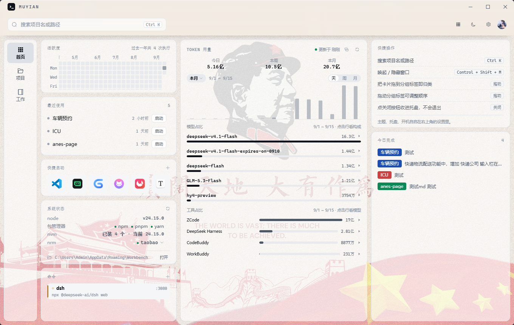
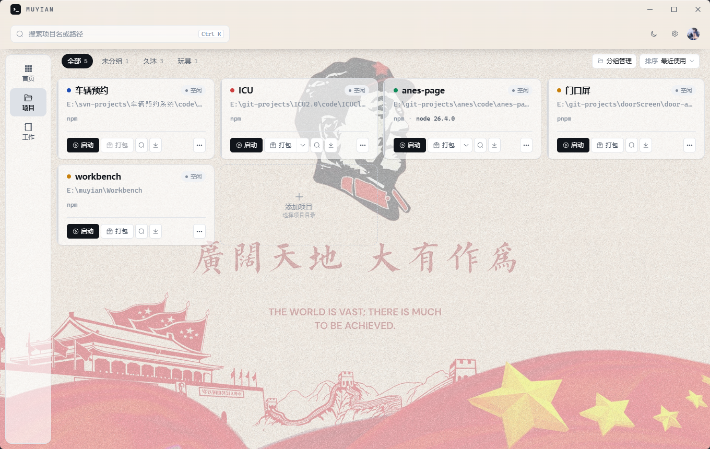
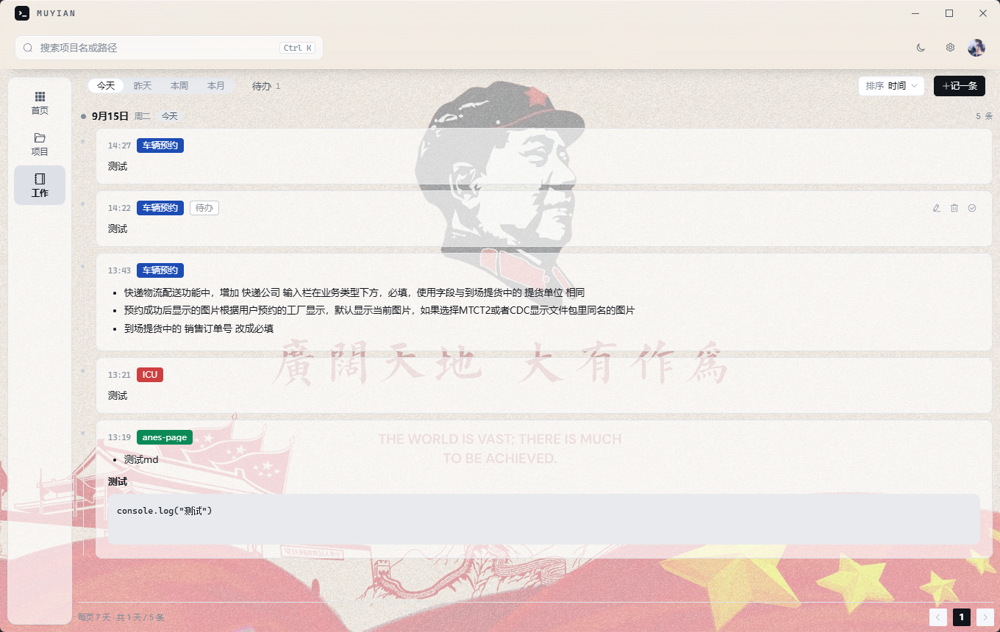
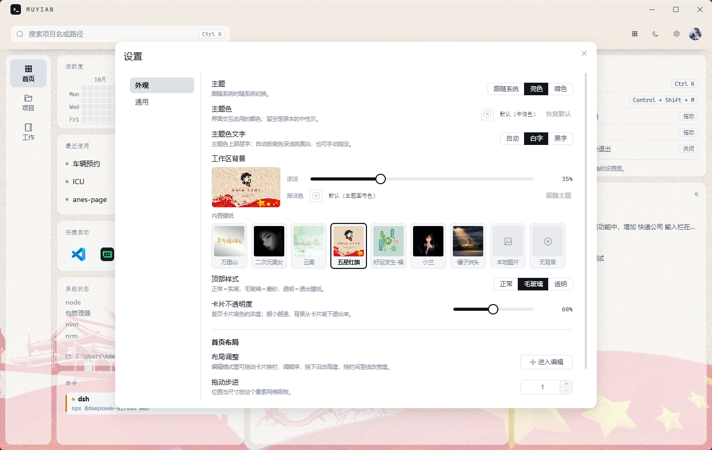

# Workbench

一个跑在 Windows 上的本地开发工作台：管项目、记工作、写笔记、看 AI 用量。
数据都在本机，默认不联网。Tauri 2 + Vue 3 + Rust 写成。

| 首页 —— 可自由布局的工作台 | 项目 —— 一键启停与打包 |
|---|---|
|  |  |
| 工作 —— 按天分组的工作日志 | 设置 —— 外观 / 菜单 / 通用 / 关于 |
|  |  |

## 能做什么

选一个项目目录，之后一键装依赖、启动、打包，命令输出在应用内终端里实时可见；按天记工作日志、
用 Markdown 写笔记、请内置的 AI Agent 到指定目录干活、看几款编程工具的 Token 用量。
此外还有首页看板、截图与钉图、网速球、邮箱、禅道通知、密码备忘、本地视频、Git 只读浏览、
ETF 资金流等一整排工具页。

每个功能的实现、边界与数据落在哪儿，见[模块文档](docs/modules/)；
跨模块的通用事实见[功能与架构](docs/features-and-architecture.md)。

## 快速开始

需要 Windows、Node.js、pnpm（版本钉在根 `package.json` 的 `packageManager`）与
Rust stable（`x86_64-pc-windows-msvc`）+ MSVC 生成工具 + Windows SDK。

```bash
pnpm install
pnpm run dev        # 开发态（Rust 后端 + 渲染层热更新）
pnpm test           # Vitest 单元测试（域包 + 渲染层，一条进程跑全量）
pnpm run typecheck  # 类型检查
pnpm run dist       # 打包出 NSIS 安装包
```

其余命令与环境前置见[功能与架构·开发](docs/features-and-architecture.md#开发)；
本机打包见[功能与架构·打包](docs/features-and-architecture.md#打包)，发版流程见[发版](docs/dev-notes/releasing.md)。

## 文档

- [功能与架构](docs/features-and-architecture.md)：跨模块的通用事实（技术栈、目录结构、数据与隐私）与模块索引
- [模块文档](docs/modules/)：每个模块一份，开头「约束」一节是不能破的规矩，后面是实现细节
- [开发笔记](docs/dev-notes/)：构建性能、浏览器验证、发版等动手方法
- [AGENTS.md](AGENTS.md)：给 AI 编码 Agent 看的工程约束（跨模块红线 + 模块索引）
- [CHANGELOG.md](CHANGELOG.md)：每个版本的变更记录
